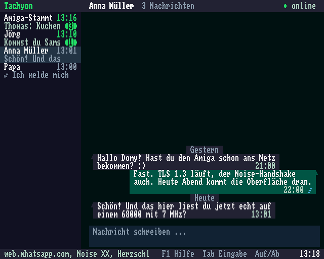
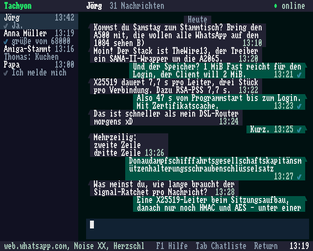

# Oberfläche

## QR-Code zum Verknüpfen (`ui/qr.c`, `ui/qr.h`)

Der A500 wird als verknüpftes Gerät angemeldet, indem das Telefon einen QR-Code vom Bildschirm liest. Der Text ist `https://wa.me/settings/linked_devices#ref,noisePub,identityPub,advSecret,<Plattform-ID>` (die drei Schlüssel Base64 mit Auffüllzeichen, je 44 Zeichen; PROTOCOL.md Abschnitt 11), live 277 ASCII-Zeichen → Version 11 L, 61 × 61 Module. Auf dem Hires-Schirm 6 × 3 Pixel je Modul (414 × 207 mit Ruhezone, Zeichnen 0,92 s); das Telefon hat diesen Code am 2026-11-27 aus dem FS-UAE-Fenster gelesen und das Pairing bestätigt (BENCHMARKS.md Schritt 19). `ui/qr.c` erzeugt daraus die Modul-Bitmap; gezeichnet wird sie vom Bildschirmcode.

Umfang: Byte-Modus, Fehlerkorrektur L oder M, Versionen 1–15 (die kleinste passende), alle acht Masken nach den vier Strafregeln bewertet, Format- und Versionsinformation, Reed-Solomon über GF(256) mit Primitivpolynom `0x11d`. Eingabe höchstens 300 Byte; die passen immer in Version ≤ 11 (L) bzw. ≤ 13 (M), die Versionen darüber erreicht man nur mit `min_version`.

### API

```c
static qr      code;    /* Ergebnis, 774 Byte */
static qr_work work;    /* Arbeitsspeicher, 1485 Byte, danach frei */

if (qr_encode(&code, &work, text, len, QR_ECC_L) == 0) {
    /* code.size Module je Seite; qr_module(&code, x, y) == 1: dunkel */
}
```

| Funktion | Zweck |
|---|---|
| `qr_encode(q, w, data, len, ecc)` | kleinste Version, beste Maske; `0` oder `-1` (Länge > 300, unbekannte Stufe) |
| `qr_encode_ex(..., min_version, mask)` | zusätzlich Mindestversion und feste Maske (0–7, `QR_MASK_AUTO`) |
| `qr_module(q, x, y)` | ein Modul lesen |
| `qr_render_pbm(q, out, cap, scale)` | PBM (P4) mit Ruhezone für den Host-Test; Länge oder `0` |

Bitmap: `q->modules`, 10 Byte je Zeile (`QR_STRIDE`, wortausgerichtet), Bit 7 des ersten Bytes ist x = 0 wie in einer Bitplane, 1 = dunkel, Bits rechts vom letzten Modul sind 0. Die Ruhezone (4 helle Module ringsum) gehört **nicht** zur Bitmap.

Zielcode: keine libc, kein `malloc`, keine Rekursion, keine variable Multiplikation oder Division (kein Laufzeithelfer nötig), Stackrahmen höchstens 60 Byte plus gesicherte Register, Tabellen `const` (GF-Logarithmen 766 Byte).

### Größe für den Pairing-Text

Der Testtext (161 Byte) ergibt auf Stufe L **Version 8, 49 × 49 Module**, auf Stufe M Version 9, 53 × 53.

| Version | Module je Seite | max. Byte L | max. Byte M |
|---|---|---|---|
| 7 | 45 | 154 | 122 |
| 8 | 49 | 192 | 152 |
| 9 | 53 | 230 | 180 |
| 10 | 57 | 271 | 213 |
| 11 | 61 | 321 | 251 |

Empfehlung: Stufe **L** (kleinere Module-Zahl; ein Bildschirm hat keine Schmutz- oder Knickschäden). Die Version hängt von der Länge der `ref` ab, die der Server liefert; der Zeichencode muss deshalb `code.size` auswerten und darf 49 nicht fest annehmen.

### Darstellung auf dem Hires-Schirm (640 × 256, 16 Farben)

**Ein Modul = 8 × 4 Pixel, nicht 4 × 4.** Ein PAL-Pixel in Hires ohne Interlace ist etwa halb so breit wie hoch (Verhältnis ≈ 0,52 : 1). Mit 4 × 4 Pixeln wäre der Code auf dem Bildschirm 1 : 1,9 gestreckt, womit Kamera-Decoder nicht zuverlässig zurechtkommen; mit 8 × 4 ist ein Modul praktisch quadratisch (1,04 : 1). Nebenbei ist ein Modul dann genau ein Byte breit: je Modul `0x00` oder `0xFF` in vier Zeilen schreiben, x auf ein Vielfaches von 8 legen, kein Schieben.

| Version | Module | Code in Pixeln | mit Ruhezone | passt in 640 × 256 |
|---|---|---|---|---|
| 7 | 45 | 360 × 180 | 424 × 212 | ja |
| 8 | 49 | 392 × 196 | 456 × 228 | ja |
| 9 | 53 | 424 × 212 | 488 × 244 | ja |
| 10 | 57 | 456 × 228 | 520 × 260 | nur mit 14 statt 16 Zeilen Ruhezone oben und unten |
| 11–13 | 61–69 | mit Ruhezone höher als 256 | – | 6 × 3 Pixel je Modul (Seitenverhältnis wie 8 × 4) |

Farben: dunkle Module in der dunkelsten Palettenfarbe, Hintergrund und Ruhezone in der hellsten, nicht invertiert. Die Darstellung auf echtem Schirm mit Telefonkamera ist noch nicht erprobt.

### Rechenzeit

FS-UAE, A500 mit 7 MHz (`tools/fsuae/a500-1mb-fast.fs-uae`), vbcc, gemessen mit `DateStamp` (1/50 s), 2026-11-27:

| Fall | Zeit |
|---|---|
| 161 Byte, L (V8), Maskenwahl | 2,5 s |
| 161 Byte, L (V8), feste Maske | 0,54 s |
| 161 Byte, M (V9), Maskenwahl | 2,9 s |
| 300 Byte, L (V11), Maskenwahl | 3,9 s |

Rund 2 s entfallen auf die Bewertung der acht Masken. Da der Pairing-Code regelmäßig mit neuer `ref` erneuert wird, kann der Client mit `qr_encode_ex(..., 1, 2)` eine feste Maske wählen; jede Maske ergibt einen gültigen Code, nur die Lesbarkeit ist nicht optimiert.

### Test

```sh
make qr-test      # braucht zbarimg (brew install zbar); python-qrcode landet in build/qr-venv
```

`tests/qr_test.c` schreibt jeden Code als PBM nach `build/qr/`, lässt ihn von `zbarimg` lesen (Ergebnis = Eingabe, byteweise) und vergleicht Version, Formatbits und alle Module mit **python-qrcode 8.2**: Pairing-Text in L und M (alle acht Masken), kurze Texte, jede Version 1–15 randvoll und mit einem Byte mehr, 300 Byte. Die Maskenwahl prüft der Test gegen eine eigene, schlichte Umsetzung der Strafregeln; python-qrcode bewertet etwas anders und wählt oft eine andere Maske, dann vergleicht der Test mit dessen Maske erzwungen. Zwei Eigenheiten der Referenzen: `segno` taugt nicht (es fügt vor den Füllbytes ein überzähliges `0x00` ein, sobald der Bitstrom schon auf einer Bytegrenze endet – im Byte-Modus immer), und python-qrcode stürzt bei Blöcken aus lauter Nullbytes ab (`glog(0)`); diesen Fall prüft nur `zbarimg`.

Einmalig von Hand geprüft (nicht Teil von `make`): die 68000-Übersetzung mit vbcc liefert unter vamos dieselben Bytes wie der Host für 1, 40, 161, 271 und 300 Byte in L und M sowie Version 15.

## Bildschirm (ui/screen.c, Stand 2026-11-27)

Der Client läuft auf einem eigenen Intuition-Screen: 640×256 (PAL Hires, nicht interlaced), 4 Bitplanes = 16 Farben, ohne Titelzeile, mit einem randlosen Backdrop-Fenster in Bildschirmgröße, das die Tastatur per IDCMP liefert. Gezeichnet wird mit graphics.library in das RastPort dieses Fensters. Quellen: `ui/screen.h` (API), `ui/screen.c`, `ui/amiga13.h` (eigene Bindings für Kickstart 1.3); Demo und Test: `bench/amiga/screen_demo.c` (`make amiga-screen`, `make run-screen`).

### Warum Intuition-Screen und keine eigene Copperliste

- **Das Betriebssystem muss weiterlaufen.** TheWire13, der SANA-II-Treiber, DOS und die CLI arbeiten unter dem Client weiter (docs/NETWORK.md). Eine eigene Copperliste hält nur, wenn man COP1LC jeden Frame selbst setzt und `GfxBase->LOFlist` auf eine Leerliste zeigt (docs/TOOLCHAIN.md, „Stolperfallen“) – das ist ein Eingriff in den View, den Intuition sich teilt, und VERTB darf nicht abgeschaltet werden (DOS-Zeit, `WaitTOF`).
- **OpenScreen liefert alles, was wir brauchen:** die vier Bitplanes (80 KiB Chip), Copperliste, ColorMap (`LoadRGB4`), den Mauszeiger-Sprite und über das Fenster die Eingabekette input.device → Intuition → IDCMP. Kein Interrupt-Handler, kein Blitter-Besitz, keine Hardware-Register.
- **Preis:** jeder graphics.library-Aufruf geht durch Layer-Lock und ClipRects, etwa 1,5 ms Grundkosten pro Aufruf (Messung unten). Für einen Chat-Client reicht das; wo es eng wird, zeichnet man Bereiche statt des ganzen Bildschirms neu oder blittet vorbereitete Templates (siehe QR).

### Bindings für 1.3 (`ui/amiga13.h`)

Wie `net/bsdsocket13.h`: vbcc-`__reg`-Inline-Stubs mit den LVO-Offsets aus den NDK-3.2-FD-Dateien (`intuition_lib.fd`, `graphics_lib.fd`, `console_lib.fd`), Basis explizit in a6. Nur V33-Funktionen: `OpenScreen`/`CloseScreen`, `OpenWindow`/`CloseWindow`, `ModifyIDCMP`, `ShowTitle`, `SetAPen`/`SetBPen`/`SetDrMd`, `RectFill`, `SetRast`, `Move`/`Draw`, `Text`/`TextLength`, `OpenFont`/`CloseFont`/`SetFont`, `LoadRGB4`/`SetRGB4`, `BltTemplate`, `WaitTOF`, `RawKeyConvert` (console.device). Die Strukturen (`NewScreen`, `Screen`-Präfix bis `BitMap`, `NewWindow`, `Window`-Präfix bis `UserPort`, `RastPort`, `ViewPort`, `TextAttr`, `TextFont`, `IntuiMessage`, `InputEvent`) sind aus NDK 3.2 R4 (Include_H) kopiert, auf die seit V33 vorhandenen Felder beschränkt; die Offsets wurden mit vbcc gegen die NDK-Header geprüft (Screen.ViewPort 44, Screen.RastPort 84, Screen.BitMap 184, Window.RPort 50, Window.UserPort 86, RastPort 100 Bytes, ViewPort 40 Bytes) und entsprechen den 1.3-Includes.

### API (`ui/screen.h`)

| Funktion | Zweck |
|---|---|
| `scr_open()` / `scr_close()` | intuition.library 33, graphics.library 33, Screen, Fenster, Topaz 8, Palette, console.device; Fehlercodes `SCR_ERR_*`. `scr_close` räumt auch nach fehlgeschlagenem `scr_open` auf und streift vor `CloseWindow` die offenen IDCMP-Nachrichten ab (1.3-Regel). |
| `scr_set_palette(rgb4, n)` | bis 16 Einträge `0x0RGB` per `LoadRGB4`; Standardpalette: 0 Schwarz, 1 Hintergrund (dunkelblau), 2 Weiß, 3 WhatsApp-Grün, 4 Dunkelgrün, 5 Türkis, 6–8 Grau, 9 Rot, 10 Gelb, 11/12 Blau, 13 Orange, 14 Beige, 15 Hellgrün (`SCR_PAL_*`). |
| `scr_clear(pen)` | `SetRast` über den ganzen Schirm |
| `scr_fill(x, y, w, h, pen)`, `scr_hline`, `scr_vline` | `RectFill`, am Bildschirmrand geclippt |
| `scr_text(x, y, pen, s)` | Topaz 8 in JAM1 (nur Glyphenpixel), `(x, y)` = linke obere Ecke der Zelle, Rückgabe Breite in Pixeln; `scr_text_bg(x, y, pen, bg, s)` in JAM2; `scr_text_width(s)` |
| `scr_bitmap_1bpp(x, y, wm, hm, bits, scale, pen_on, pen_off)` | QR-Modulmatrix: `wm × hm` Module, zeilenweise, Zeilen auf ganze Bytes aufgefüllt, MSB zuerst, 1 = dunkel; jedes Modul wird `scale × scale` Pixel. Expandiert die Matrix zeilenweise (Fast-RAM-Puffer, Tabellen für Breite 1/2/4/8) in ein Chip-RAM-Template und zeichnet es mit einem `BltTemplate` (JAM2). `scr_bitmap_1bpp_rects` ist der `RectFill`-Fallback (Läufe gleichfarbiger Module), auch wenn kein Chip-RAM frei ist. |
| `scr_bitmap_1bpp_ex(x, y, wm, hm, bits, stride, sx, sy, pen_on, pen_off)` | allgemeine Form für den Encoder oben: `stride` Bytes je Quellzeile (`QR_STRIDE` 10), `sx × sy` Pixel je Modul – für den Bildschirm **8 × 4** (ein Byte je Modul, siehe QR-Abschnitt zum Seitenverhältnis), 6 × 3 für große Versionen. `scr_bitmap_1bpp_rects_ex` entsprechend. Aufruf für einen Code `q`: `scr_bitmap_1bpp_ex(x, y, q->size, q->size, q->modules, QR_STRIDE, 8, 4, 0, 2)` nach einem `scr_fill` der Ruhezone (4 Module = 32 × 16 Pixel) in Pen 2. |
| `scr_wait_key(ticks)` | wartet bis `ticks` Frames (1/50 s; `SCR_FOREVER`, 0 = nur abfragen) auf eine Taste: ASCII (8 Backspace, 9 Tab, 13 Return, 27 Escape, 127 Del, 32–126, ISO-8859-1 für Umlaute unter deutscher Keymap), `SCR_KEY_RAW \| Rawcode` für Tasten ohne Zeichen (Cursor `$4C–$4F`, F1–F10 `$50–$59`, Help `$5F`), `SCR_KEY_TIMEOUT`. Tastenloslassen und reine Qualifier werden übersprungen. Wartet mit `WaitTOF` (Task schläft) statt zu pollen; ohne Timeout mit `Wait` auf das Port-Signal. |
| `scr_translate_raw(code, qual)` | dieselbe Übersetzung für einen Rawcode (Selbsttest, Replay); `scr_last_key_source()` sagt, woher die letzte Taste kam |
| `scr_screen()`, `scr_window()`, `scr_rastport()`, `scr_font_height()`, `scr_font_width()`, `scr_console_ok()` | Zugriff für spätere Module |

Nicht reentrant: ein Screen pro Programm, Zustände statisch. Kein DOS-Bezug in `ui/screen.c` (nur exec, intuition, graphics, console.device); `SysBase` wird aus Adresse 4 gelesen.

### Tastatur

Das Fenster ist mit `IDCMP_RAWKEY | IDCMP_VANILLAKEY` geöffnet. Drei Wege liefern Zeichen:

1. **VANILLAKEY** (`'V'`): Intuition hat die Taste selbst über die Systemkeymap in ein Zeichen übersetzt. Kommt auf 1.3 für Tasten, die genau ein Zeichen ergeben.
2. **RAWKEY → `RawKeyConvert`** (`'C'`): console.device wird mit Unit `CONU_LIBRARY` (−1) geöffnet und als Library benutzt (LVO −48, V33). Keymap `NULL` = die Systemkeymap (Preferences bzw. `SetMap`), also funktionieren deutsche Belegungen (y/z, Umlaute) ohne eigene Tabelle. Dead-Key-Informationen (`IAddress`) werden durchgereicht. Mehrzeichen-Ergebnisse (CSI-Sequenzen der Cursor- und F-Tasten) werden zu `SCR_KEY_RAW | Code`.
3. **Eingebaute US-Tabelle** (`'T'`): nur wenn console.device nicht öffnet. Rawcodes `$00–$5F` (Reihe `` `1234567890-=\ ``, `qwertyuiop[]`, `asdfghjkl;'`, `zxcvbnm,./`, Ziffernblock, `$40` Space, `$41` Backspace, `$42` Tab, `$43` Enter, `$44` Return, `$45` Esc, `$46` Del), Shift und Caps Lock für Buchstaben, Ctrl bildet auf `$00–$1F` ab. Kein Deutsch.

keymap.library gibt es auf 1.3 nicht (ihre Funktionen sind laut `keymap_lib.fd` V36+), deshalb console.device. Der Selbsttest der Demo schickt Rawcodes durch denselben Pfad: `$20`→`a`, `$20`+Shift→`A`, `$01`→`1`, `$40`→Space, `$44`→13, `$41`→8, `$45`→27, `$4C`→`SCR_KEY_RAW|$4C`, `$A0` (Loslassen)→ignoriert – alle korrekt über `'C'` (FS-UAE, Standardkeymap usa0). Der VANILLAKEY-Weg und eine deutsche Keymap sind nur mit echtem Tastendruck prüfbar (FS-UAE-Lauf ohne Bildschirmzugriff). Live-Lauf 8 (2026-11-28) zeigte: ohne `SetMap` gilt die ROM-Keymap `usa0`, also y/z vertauscht und keine Umlaute, weil FS-UAE die physischen Tastenpositionen des Mac-Keyboards schickt. Seitdem setzt `tools/run-fsuae-net.sh` `setmap d` in der Startup-Sequence (`C:SetMap` von der Workbench-Boot-Disk, `Devs/Keymaps/d` von der Extras-Disk, Variablen `KEYMAP`/`WBEXTRAS`, siehe NETWORK.md). Eine eingebaute deutsche Keymap (eigener `struct KeyMap` als viertes Argument von `RawKeyConvert`) wäre die Workbench-freie Dauerlösung.

### Messungen (FS-UAE, A500 zyklengenau, 512 KiB Chip + 1 MiB Fast, `make run-screen`, 2026-11-27)

Zeiten aus `DateStamp`-Ticks (20 ms), daher jede Operation mehrfach wiederholt und gemittelt.

| Schritt | Messung |
|---|---|
| `scr_open` (Libraries, OpenScreen, OpenWindow, OpenFont, LoadRGB4, console.device) | 220–260 ms |
| `scr_close` | 160 ms |
| Chip-RAM durch den Screen | **82 120 Bytes** = 81 920 (4 Planes × 80 × 256) + 200 (Copperliste, ColorMap, Sprite); Fast 2 016 Bytes (Screen-, Window-, Layer-Strukturen). Nach `scr_close` sind Chip und Fast exakt wieder auf dem Stand vor dem Öffnen. |
| `scr_clear` (SetRast 640×256×4 durch den Layer) | 88 ms |
| Titelzeile (`scr_fill` 640×12 + zwei `scr_text`) | 32 ms |
| `scr_fill` 36×14 | 1,7 ms |
| `scr_hline` 300 px / `scr_vline` 4 px | 1,5 ms (reine Aufruf-Grundkosten: Layer-Lock, ClipRect, Blitter-Setup) |
| `scr_fill` 228×228 | 30 ms |
| Textblock: 10 Zeilen à ≈45 Zeichen Topaz 8 + 1 JAM2-Zeile | 200 ms, also ≈ 18 ms pro Zeile, ≈ 0,4 ms pro Zeichen (`Text()` blittet in 1.3 Zeichen für Zeichen). Ein voller Schirm mit 80×32 Zeichen wäre ≈ 1 s. |
| QR 49 Module, 4 × 4 Pixel (196 × 196): Ruhezone + `scr_bitmap_1bpp` | **120 ms** (30 ms Ruhezone-Fill + ≈55 ms CPU-Expansion/AllocMem + 30 ms `BltTemplate` 196×196 in 4 Planes). Erste Fassung mit bitweiser Expansion direkt ins Chip-RAM: 456 ms; Expansion in Fast-RAM-Zeilenpuffer mit Wortkopien: 240 ms; tabellengetrieben (Nibble→Wort für Breite 4, Byte→Wort für 2, Byte je Modul für 8): 116–120 ms. |
| QR 49 Module, **8 × 4 Pixel** (392 × 196, das Format des Clients), `scr_bitmap_1bpp_ex`, Stride 10 | **188 ms** ohne Ruhezone |
| QR 49 Module, 6 × 3 Pixel (generischer Bitpfad) | 280 ms |
| dieselbe 4 × 4-Matrix per `scr_bitmap_1bpp_rects` | 1 830 ms (≈1 200 `RectFill`-Aufrufe à 1,5 ms) – nur Fallback |
| `scr_wait_key(500)` ohne Taste | 10 000 ms, Timeout tickgenau |
| Demo gesamt | ≈ 35 s inklusive 10 s Warten (FS-UAE-Lauf mit Boot ≈ 50 s, `make run-screen` wartet bis 60 s) |

Folgerungen für den Client: Bereiche statt des ganzen Schirms neu zeichnen (ein `scr_clear` kostet 4–5 Frames); Text zeilenweise und nur geänderte Zeilen; große Grafiken als Template vorbereiten und blitten. Ein eigener 8×8-Textrenderer direkt in die Planes (CPU, am Layer vorbei – im randlosen Backdrop-Fenster ohne Überlappung erlaubt) wäre die nächste Stufe, falls 0,4 ms/Zeichen stören.

### Grenzen von Kickstart 1.3

- **Keine Tags:** `OpenScreenTagList`/`OpenWindowTagList`, `SA_*`/`WA_*` sind V36. Es gibt nur `struct NewScreen`/`struct NewWindow`; Auflösung über `ViewModes` (`HIRES`, optional `LACE`), Typ `CUSTOMSCREEN`. Keine Display-IDs, kein Overscan-Prefs-Zugriff, keine `SA_Quiet`-Variante außer `SCREENQUIET`.
- **Titelzeile:** ein Custom-Screen hat immer die Titelzeilen-Layer; verbergen lässt sie sich nur hinter Backdrop-Fenstern (`ShowTitle(screen, FALSE)`), deshalb das randlose Backdrop-Fenster in voller Größe. `ScreenToFront` ist nach `OpenScreen` unnötig (der neue Screen liegt vorn); es sind keine Depth-Gadgets vorhanden, der Nutzer kann den Screen nicht per Maus nach hinten legen – Umschalten zur Workbench ginge nur per Amiga-N/M (Intuition-Tastenkürzel, funktioniert).
- **Fonts:** `NewScreen.Font` auf Topaz 8 (`FPF_ROMFONT`), zusätzlich `OpenFont` + `SetFont` auf das Fenster-RastPort, damit die Preferences-Schrift (Topaz 9 bei 60 Hz) nicht hineinspielt. Diskfonts bräuchten diskfont.library und Disk-Zugriff; nicht vorgesehen. `Text()` auf 1.3 ist langsam (siehe oben), `TextLength` wird genutzt, um Strings am rechten Rand zu kürzen (Text() rendert sonst den vollen String in den Clip).
- **Tastatur:** keine keymap.library; console.device als Library, siehe oben. `IDCMP_VANILLAKEY` ist vorhanden.
- **Speicher:** Backdrop-Fenster mit `WFLG_SIMPLE_REFRESH | WFLG_NOCAREREFRESH`, damit kein Smart-Refresh-Puffer angelegt wird; `WFLG_RMBTRAP` unterdrückt die Menüleiste bei rechter Maustaste.
- **Zeichnen im Fenster-RastPort statt im Screen-RastPort:** geht durch den Layer (Clipping, Lock) und kostet die genannten 1,5 ms pro Aufruf, bleibt aber mit Intuitions eigener Darstellung konsistent. Direktes Zeichnen in `Screen.RastPort` (ohne Layer) wäre schneller, würde aber die (verborgene) Titelzeile übermalen und bei Requestern/Alerts kollidieren.

### Offen

- Mausunterstützung (IDCMP_MOUSEBUTTONS/`MOUSEMOVE`) bei Bedarf; Qualifier-Rückgabe für Shift/Ctrl-Kombinationen.
- Prüfung des VANILLAKEY-Pfades und einer deutschen Keymap mit echtem Tastendruck (manuell in FS-UAE).
- ~~Eigener Textrenderer, falls die Chat-Ansicht mehr als ein paar Zeilen pro Sekunde schreiben muss.~~ Umgesetzt: `ui/ftext.c`, siehe „Client-Oberfläche“.

## Client-Oberfläche (ui/gui.c, Stand 2026-11-28)

Die Chat-Oberfläche des Clients auf dem Hires-Schirm aus dem vorigen Abschnitt: ein Modul mit Modell (Chats, Nachrichtenspeicher) und Ansicht, ohne Bezug zu Netz oder Kryptografie. Quellen: `ui/gui.h` (API), `ui/gui.c`, `ui/ftext.c` (eigener Textrenderer), `ui/font8.c` (Glyphentabelle). Host-Renderer `ui/screen_host.c`, Test `tests/gui_test.c` (`make gui-test`, Teil von `make host-test`, Renderings `make gui-png` → `build/gui-*.png`), Amiga-Demo `bench/amiga/gui_demo.c` (`make run-gui`).

<p align="center"> </p>

### Aufbau des Bildschirms

80 Spalten × 32 Zeilen Topaz 8; Zeilenangaben in Pixeln. PAL-Hires-Pixel sind etwa halb so breit wie hoch, die Bilder oben sind deshalb mit verdoppelten Zeilen gerendert (640 × 512), so sieht es der Monitor.

```
 y 0    ┌────────────────────────────────────────────────────────────────────────────────┐
        │ Tachyon            Anna Müller  3 Nachrichten                        ● online │  Kopfzeile (12 px)
 y 14   ├───────────────────┬────────────────────────────────────────────────────────────┤
        │ Amiga-Stammt 13:16│                                                            │
        │ Thomas: Kuchen (3)│                        ( Gestern )                         │
        │ Jörg        13:10 │ ◢ Hallo Domy! Hast du den Amiga schon ans Netz             │  Chatliste: 14 Einträge
        │ Kommst du Sams (1)│   bekommen? :)                                 21:00       │  à 2 Zeilen (20 Spalten)
        │▌Anna Müller 13:01▐│            Fast. TLS 1.3 läuft, der Noise-Handshake ... ◣  │
        │▌Schön! Und das   ▐│            auch. Heute Abend kommt die Oberfläche dran.    │  Gespräch: 25 Zeilen
        │ Papa        13:00 │                                              22:00 ✓✓      │  (Spalten 22–78)
        │ ✓ Ich melde mich  │                        (  Heute  )                         │
        │                   │ ◢ Schön! Und das hier liest du jetzt echt auf              │
        │                   │   einem 68000 mit 7 MHz?                        13:01      │
 y 223  │                   ├────────────────────────────────────────────────────────────┤
        │ ▲ 2   ▼ 3 weitere │ Grüße vom 68000-Amiga!█                                    │  Eingabe: 2 × 55 Zeichen
 y 246  ├───────────────────┴────────────────────────────────────────────────────────────┤
        │ web.whatsapp.com, Noise XX, Herzschl  F1 Hilfe  Tab Eingabe  Auf/Ab     13:18  │  Statuszeile
        └────────────────────────────────────────────────────────────────────────────────┘
```

- **Kopfzeile** (Pen 5, dunkel): Titel grün fett, Name des offenen Chats fett mit Nachrichtenzahl, rechts Verbindungszustand mit farbigem Punkt (grün online, gelb verbinde/Handshake, rot offline/Fehler).
- **Chatliste** (links, 20 Spalten, eigener Hintergrund Pen 8): sortiert nach letzter Aktivität. Zeile 1 Name (12 Zeichen) und Uhrzeit der letzten Nachricht (grün bei Ungelesenem), Zeile 2 Vorschau (eigene Nachricht mit Haken davor) und rechts die Ungelesen-Pille `(3)` in Grün mit runden Kappen (eigene Glyphen). Der gewählte Chat steht auf Pen 12. Bei mehr als 14 Chats zeigt die Fußzeile `▲ n` / `▼ n weitere`.
- **Gespräch** (rechts, 57 Spalten, 25 Zeilen): Sprechblasen mit Zeilenumbruch bei 44 Zeichen (Wortgrenzen, harte Trennung bei Überlänge, `\n` wird beachtet), höchstens 46 Zellen breit. Eingehende Blasen links auf Pen 5 mit Zipfel `◢` am ersten Zeilenanfang, eigene rechts auf Pen 4 (WhatsApp-Dunkelgrün) mit Zipfel rechts. In der letzten Zeile (oder einer eigenen Fußzeile, wenn kein Platz) die Uhrzeit `HH:MM` und bei eigenen Nachrichten der Status: Uhr (ausstehend), ✓ (gesendet), ✓✓ (zugestellt), ✓✓ blau (gelesen), `!` rot (fehlgeschlagen). Zwischen Tagen eine Datumspille (`Heute`, `Gestern`, sonst `TT.MM.JJJJ`). Die Anzeige ist unten verankert; nach oben wird geblättert.
- **Eingabe** (Pen 15, 21 px hoch): eine logische Zeile bis 400 Zeichen, dargestellt als Fenster von 2 × 55 Zeichen, das waagerecht mitläuft (`<` / `>` am Rand zeigen abgeschnittenen Text). Cursor als inverse Zelle, im Überschreibmodus gelb und mit `U` rechts unten. Ohne Fokus und leer steht der Platzhalter „Nachricht schreiben ...“.
- **Statuszeile**: links der Verbindungstext aus `gui_set_connection` (36 Zeichen), in der Mitte die Tastenhinweise zum aktuellen Fokus (nach einem Esc „Esc nochmal: Beenden“), rechts die Uhr.
- **Hilfe** (F1/Help): Kasten über dem Gespräch mit allen Tasten; jede Taste schließt ihn und wird verschluckt.

Palette (`gui_palette`, 0x0RGB): 0 Schwarz, 1 `011` Gesprächshintergrund, 2 `EEE` Weiß, 3 `2D6` Grün, 4 `054` eigene Blase, 5 `223` Kopf/Blasen, 6 `ACB` Hellgrau, 7 `89A` Grau, 8 `112` Listenhintergrund, 9 `E55` Rot, 10 `ED5` Gelb, 11 `5BE` Blau (gelesen), 12 `234` Auswahl/Hilfe, 13 `F93` Orange, 14 `456` Rahmen, 15 `123` Eingabe. `gui_redraw_all` lädt sie; die `SCR_PAL_*`-Nummern aus `screen.h` gelten in der GUI nicht.

### Tasten

| Taste | Wirkung |
|---|---|
| Tab | Fokus zwischen Chatliste und Eingabe; ein Zeichen tippen holt den Fokus ebenfalls in die Eingabe |
| Maus, linke Taste | Klick auf einen Listeneintrag wählt den Chat (`GUI_ACT_SWITCH`) und setzt den Fokus in die Eingabe; Klick ins Eingabefeld holt den Fokus; Klick in die obere Hälfte des Gesprächs blättert eine Seite zurück, untere Hälfte vor; Klick auf die Listenfußzeile blättert die Liste (linke Hälfte ↑, rechte ↓, ohne die Auswahl zu ändern). `SCR_KEY_MOUSE` aus `IDCMP_MOUSEBUTTONS`, Position über `scr_last_mouse`; rechte Taste bleibt wegen `WFLG_RMBTRAP` stumm. Kein Mausrad auf dem A500 |
| Auf / Ab | Fokus Liste: Chat wählen (das Gespräch folgt sofort, `GUI_ACT_SWITCH`); Fokus Eingabe: Verlauf zeilenweise |
| Shift+Auf / Shift+Ab | Verlauf seitenweise (24 Zeilen), in beiden Fokussen; der A500 hat keine PgUp/PgDn |
| Return | Fokus Liste: Chat öffnen (Fokus in die Eingabe); Fokus Eingabe: senden (`GUI_ACT_SEND`), Eingabe leeren |
| Links / Rechts | Cursor; mit Shift: Zeilenanfang / -ende (kein Home/End auf dem A500); auch Ctrl-A / Ctrl-E |
| Backspace, Del | Zeichen vor bzw. unter dem Cursor löschen; Ctrl-K löscht bis zum Ende |
| F2 | Einfügen ↔ Überschreiben |
| Esc | Eingabe löschen; bei leerer Eingabe zweimal hintereinander: `GUI_ACT_QUIT` |
| Amiga+Q | `GUI_ACT_QUIT` (Qualifier über `scr_last_qualifier`) |
| F1, Help | Hilfe ein/aus |

Umlaute: `scr_wait_key` liefert unter deutscher Keymap ISO-8859-1-Codes, die Eingabe hält sie so; `gui_take_outgoing` kodiert nach UTF-8 (`ä` → `C3 A4`), der Test prüft den Rundweg.

### API (`ui/gui.h`)

| Funktion | Zweck |
|---|---|
| `gui_init(arena, size)` | nach `scr_open()`; teilt die Arena, liest die Topaz-Glyphen aus dem ROM-Font (`scr_font_glyphs`) und die Planes (`scr_planes`); `-1` unter 8 KiB |
| `gui_add_chat(jid, name)` → Index | bis 32 Chats; Name UTF-8 oder Latin-1 (wird erkannt), 24 Zeichen; bekannte JID liefert den vorhandenen Index |
| `gui_find_chat(jid)`, `gui_set_chat_name`, `gui_chat_jid`, `gui_chat_count`, `gui_current_chat`, `gui_select_chat` | Chatverwaltung; `gui_select_chat` setzt Ungelesen auf 0 und springt ans Ende |
| `gui_add_message(chat, from_me, ts, utf8, len, status)` → id | Text UTF-8 (`len` oder −1), bis 500 Byte (Schnitt an Codepunktgrenze); Unix-Sekunden, `HH:MM` wird mit `gui_set_tz` berechnet; `status` `GUI_ST_*`; 0 wenn nichts gespeichert werden konnte |
| `gui_set_status(chat, id, status)` | Haken nachziehen (`chat` ist nur ein Hinweis, die id ist eindeutig); −1 wenn die Nachricht schon verdrängt ist |
| `gui_set_connection(state, detail)` | `GUI_CONN_OFFLINE/CONNECTING/HANDSHAKE/ONLINE/ERROR` und Kurztext für die Statuszeile |
| `gui_set_time(unix_now)`, `gui_set_clock(hh, mm)`, `gui_set_tz(sek)` | Uhr und „Heute“ für die Datumspillen; Zeitzone in Sekunden östlich UTC (Default 0) |
| `gui_pump(key)` → `GUI_ACT_*` | ein Ergebnis von `scr_wait_key` (auch `SCR_KEY_TIMEOUT`); blockiert nie |
| `gui_action_chat()`, `gui_take_outgoing(buf, cap)` | Chat des letzten `SEND`/`SWITCH`; der Text als UTF-8 (NUL-terminiert, Länge zurück) |
| `gui_redraw_dirty()` → gezeichnete Zellzeilen | nur Geändertes; `gui_redraw_all()` lädt die Palette und malt alles (Start, nach Fremdzeichnung) |
| `gui_set_text_mode(GUI_TEXT_FAST/OS)`, `gui_set_scroll_mode(GUI_SCROLL_BLIT/CPU/REDRAW)` | Zeichenpfade (Messung unten); Default schnell + ScrollRaster |
| `gui_stats(&s)` | Nachrichten, Slots, Textring, Verworfenes, gezeichnete Zeilen, Scrolls |
| `gui_utf8_to_latin1`, `gui_latin1_to_utf8` | die Konvertierungen, auch einzeln nutzbar |

### Einbindung in die Probe (Stand 2026-11-28)

Seit dem 2026-11-28 ist die Oberfläche in die A500-Probe eingebaut (`bench/wa_probe_amiga.c`; Unity-Build `bench/amiga/wa_probe_unity.c` zieht `ui/font8.c`, `ui/ftext.c`, `ui/gui.c` nach `ui/screen.c`). Im Pairing-/Login-Modus (`SYS:pair.txt`, also `make run-pair` und `make run-chat`) gehört der Hires-Schirm der GUI vom Programmstart bis 20 s nach dem Ende; der reine Verbindungstest (`make run-probe`) läuft weiter ohne Schirm. Die beiden Statuszeilen und das Konsolenfenster als Eingabe sind damit abgelöst (das CON:-Fenster bleibt als Fallback für getippte Zeilen und für das Log).

**Der Core meldet, die GUI zeigt.** `tests/wa_probe_core.c` kennt die GUI nicht; sein `wa_probe_io` hat sechs optionale Callbacks, alle nur berichtend (Protokollverhalten unverändert, Host-Glue und Simulator setzen sie nicht bzw. nur zum Mitzählen):

| Callback | wann | A500-Glue daraus |
|---|---|---|
| `on_state(state, detail)` | TLS beginnt, WebSocket offen, Noise angenommen, `<success>`, `<active/>`, Close, Fehler (`WA_CONN_*`) | `gui_set_connection` mit deutschem Kurztext; DNS und TCP meldet das Glue selbst |
| `on_time(unix)` | jedes Stanza mit `t=` (`<success>`, `<message>`, `<receipt>`, `<notification>`) | Uhr und „Heute“ laufen ab dann mit der Serverzeit (`now_ms`-Anker), vorher mit der Amiga-Uhr, wenn sie gestellt ist |
| `on_text(user, device, lid, pushname, ts, utf8, len)` | entschlüsselter Text, UTF-8 wie empfangen, `notify`-Attribut als Pushname | Chat anlegen oder finden (eigene Nummer/LID → Selbst-Chat „Du“, sonst `nummer@s.whatsapp.net` bzw. `lid@lid`, Name = Pushname, sonst Nummer), `gui_add_message(…, 0, ts, …)` |
| `on_sent(user, device, lid, text, msg_id, ok)` | `send_text` fertig (auch für das Skript-`CHAT_SEND` und Konsolenzeilen) | Nachrichten-ID ↔ GUI-ID merken (8 Einträge); Skripttext bekommt eine eigene Blase; `ok = 0` → `!` |
| `on_ack(msg_id, status)` | `<ack class=message>` (SENT, mit `error` FAILED), `<receipt>` (DELIVERED, `type=read` READ) | `gui_set_status` über die gemerkte ID; fremde IDs werden ignoriert |
| `chat_input_to(user, device, lid, line)` | einmal je Durchlauf der Linger-Schleife (≤ 1 s) | die nächste Zeile aus der GUI-Warteschlange mit dem Ziel des gewählten Chats, sonst eine Konsolenzeile an `chat_user`; Esc Esc / Amiga-Q → `/quit` |

**Takt.** Der Core blockt in `io->recv` bis zu 1 s; das Glue legt das IDCMP-Signal des Fensters (`scr_wake_mask`) in die Signalmaske von `WaitSelect`, sodass ein Tastendruck das Warten sofort beendet, zerlegt das Warten zusätzlich in 200-ms-Scheiben (Stacks ohne Signalmasken-Unterstützung: ein `-1` schaltet die Maske dauerhaft ab) und ruft `gui_tick()` (`scr_wait_key(0)`, `gui_pump`, Uhr, `gui_redraw_dirty`) nach jedem Aufwachen und alle 200 ms auch dann, wenn jeder `recv` Daten liefert (Live-Läufe 6 bis 7b: 117 bis 143 Ticks in rund drei Minuten, weil während der 60 s Empfang des Offline-Stapels kein Warten leer auslief; Tasten stauten sich, bis der Strom pausierte). Während der 68000 rechnet (X3DH ≈ 1 min) kommt derselbe Tick alle 200 ms aus dem `CRYPTO_YIELD`-Hook, der schon die Fortschrittspunkte druckt. Polls mit Timeout 0 (Heartbeat-Drain) laufen ungebremst durch; ein Wiedereintrittsschutz verhindert einen Tick im Tick, und solange ein QR-Code steht, zeichnet die GUI nicht (danach `gui_redraw_all`). Eine getippte Zeile wird sofort als ausstehende Blase (Uhr) gezeigt, in eine Warteschlange (4 Zeilen, 500 Byte UTF-8) gestellt und vom Core über `chat_input_to` abgeholt; Senden heißt dann wie bisher Bundle/X3DH bei neuer Sitzung (≈ 54 s, die GUI bleibt bedienbar), Verschlüsseln, `<message>`; der Haken kommt mit dem Server-Ack.

**Speicher.** Die Arena (48 KiB) liegt im **Chip-RAM**: auf der 2-MiB-Maschine lassen Probe (jetzt 600 KB Hunks) und TheWire13 rund 115 KB Fast-RAM (Live-Versuch 4), davon nehmen GUI-Code und -Statik schon ≈ 90 KB; Chip hat nach den 80 KiB Bitplanes ≈ 100 KB frei, und die Arena wird nur vom Modell gelesen (`gui_add_message` 3 ms). Fast-RAM bekommt die Arena nur, wenn über 1 MiB zusammenhängend frei ist. Das Log meldet `gui: … arena 48 KiB in Chip RAM, Fast RAM a -> b bytes free`, die `GUI:`-Zeile am Ende Ticks, Durchschnitt/Maximum je Tick, Ticks über 100 ms, Nachrichten, verworfene, gezeichnete Zeilen, Scrolls.

**Was auf dem Schirm steht** (Chatliste → Selbst-Chat „Du“, der `chat.txt`-Partner, die Partner der gespeicherten Sitzungen; Kopfzeile/Status): „Schlüssel werden berechnet“ → „Warte auf den TCP/IP-Stack“ → „DNS: web.whatsapp.com“ → „TCP zu a.b.c.d:443“ → „TLS 1.3 zu web.whatsapp.com“ → „WebSocket offen, Noise XX“ → „Noise XX steht, Anmeldung“ → „angemeldet als :N, passiv“ → „web.whatsapp.com, Noise XX, online“ → „Verbindung beendet“ / „Fehler: …“, am Ende „Ende – Taste schließt“ (20 s). Eingehende Texte stehen links (auch im Selbst-Chat, damit zu sehen ist, was vom Telefon kam), gesendete rechts mit Uhr → ✓ → ✓✓.

**Live-Lauf 6 (2026-11-28, BENCHMARKS.md Schritte 25 und 26):** GUI 1,5 s nach Programmstart, „online“ bei 54,7 s, 143 Ticks à 19 ms (Maximum 300 ms), die getippte Zeile als ausstehende Blase; die Verbindung endete im Offline-Stapel, bevor die Zeile gesendet wurde. Daraus behoben: ein Tick holt alle wartenden Tasten (vorher eine je 200 ms – „Zeitlupeneingabe“ während der 68000 rechnet), die Uhr folgt nur `t=`-Werten von Nicht-Offline-Stanzas und nie rückwärts.

**Live-Lauf 8 (2026-11-28, BENCHMARKS.md Schritt 27):** 22 Minuten online, vier in der GUI getippte Zeilen gesendet und vom Server bestätigt (Acks 1 bis 9 s später, auf dem Telefon zwei blaue Haken); 4626 Ticks à 8 ms (Maximum 280 ms). Tasten kamen gebündelt und das Layout war US (y/z, keine Umlaute); beides danach behoben (b78b358, f26953c), Prüfung in Lauf 9. **Lauf 9** bestätigte beides: deutsches Layout über `setmap d`, Tasten ohne Stau, fünf Zeilen gesendet mit Acks nach 0,5 bis 0,8 s, 1513 Ticks à 9 ms. Die Statustexte des Glues müssen UTF-8 sein (`gui_set_connection` konvertiert; Latin-1 ergab „Schl?ssel“, 2ccf385). **Läufe 11 bis 14:** der Empfangspfad stand bis Lauf 13 hinter nie quittierten `<status>`-Stanzas (Core-Fix 6359a93) und einer Sitzung unter der falschen Adresse (67149c6); in Lauf 14 kamen 12 Nachrichten in die GUI, zwei Chats. Vom Nutzer gemeldet: je Nachricht ≈ 4 s statt 1 s (Sitzungsdatei wird nach jeder Nachricht geschrieben, 1,3 s; Vorschlag an den Core: im Leerlauf schreiben), und der Wechsel in den zweiten Chat gelang nicht (Tab bis die Statuszeile „Tab Eingabe  Auf/Ab“ zeigt, dann Pfeiltasten; die Pfeiltasten über die deutsche Keymap sind live noch unverifiziert).

Offen bleibt: Zeitzone fest CET (`gui_set_tz(3600)`), Namen nur aus `notify` (keine Kontaktliste), Gruppen werden nicht angezeigt (der Core bestätigt sie nur), Esc Esc beendet den Lauf (für Tests riskant: ein Tipp-Fehler schließt die Verbindung).

### Nachrichtenspeicher

`gui_init` teilt die Arena in **Deskriptoren** (ein Viertel, 16 Byte je Nachricht) und den **Textring** (der Rest). Mit 48 KiB: 768 Deskriptoren (12 KiB) + 36 864 Byte Text, bei ≈ 50 Byte je Nachricht reichen beide gleich weit.

```
Deskriptor (16 Byte):  id:4  ts:4  toff:2  tlen:2  chat:1  flags:1 (Bit 0 from_me, Bits 1–3 Status)  hh:1  mm:1
Textring:              UTF-8 wie empfangen, zusammenhängend je Nachricht; passt der Text nicht mehr ans Ende,
                       beginnt er bei 0 (Lücke am Ende bleibt frei)
```

Beide sind Ringe in Ankunftsreihenfolge: ist einer voll, fällt die älteste Nachricht des ganzen Speichers (damit auch die älteste ihres Chats), bis Platz ist; `gui_stats().dropped` zählt. Ein Text länger als der Ring wird abgewiesen, 500 Byte pro Nachricht sind die Obergrenze. Nachrichten-IDs sind laufende 32-Bit-Nummern, `gui_set_status` sucht von der jüngsten rückwärts. Für das Gespräch wird je Chat rückwärts gelaufen (nächste ältere Nachricht desselben Chats, linear), umgebrochen wird nur, was in die 25 Zeilen plus Blätterabstand fällt; der Latin-1-Text der zuletzt umgebrochenen Nachricht bleibt gecacht.

Statischer Speicher der GUI außer der Arena: Chats 32 × 92 Byte, Zeilentabellen 2 × 25 × 16, Eingabe 2 × 401, Konvertierpuffer 504, Glyphentabelle 2 KiB (`font8_glyphs`), Zellzeile 320, Schattenpuffer 9 KiB – zusammen ≈ 18 KiB, mit Arena ≈ 66 KiB Fast-RAM (Budget in der README: 64 KiB neben den 80 KiB Bitplanes; die 2 KiB Überhang kauft der Schattenpuffer, der jede Neuzeichnung auf die geänderten Zellen beschränkt).

### Zeichnen

Jede Region wird als **Zellzeile** (Zeichen, Vordergrund, Hintergrund, Stil) zusammengesetzt; ein **Schattenpuffer** hält für jede Textzeile des Schirms (Kopf, 28 Listenzeilen, Fußzeile, 25 Gesprächszeilen, 2 Eingabezeilen, Status, 13 Hilfezeilen; 2 993 Zellen × 3 Byte ≈ 9 KiB) die zuletzt gemalten Zellen. Gemalt werden nur Zellen, die sich davon unterscheiden, in Läufen (Lücken bis 2 Zellen werden mitgenommen, ein Aufruf statt zwei). Ein Statushaken kostet so zwei Zellen, die Uhr fünf, ein Tastenecho zwei.

**Erkenntnis der Messung (FS-UAE, zyklengenau):** in 640 × 256 mit vier Bitplanes nimmt die Bitplane-DMA während der sichtbaren Zeilen den gesamten Chip-Bus, die CPU bekommt insgesamt nur rund ein Drittel der Chip-Zugriffe. Eine 8 × 8-Zelle per CPU in die vier Planes kostet dadurch **≈ 280 µs** (im Fast-RAM wären es ≈ 100 µs), ein CPU-Fill ≈ 90 µs je Zelle – der Blitter füllt dieselbe Fläche fünfmal schneller (`RectFill` 464 × 200: 48 ms, CPU 280 ms), zahlt aber 1,5 ms Grundkosten je Aufruf. Daraus die Mischung:

- **Flächen und Leerläufe ab 3 Zellen: Blitter** (`scr_fill` → `RectFill`), darunter CPU.
- **Text: CPU** (`GUI_TEXT_FAST`, Default): `ui/ftext.c` schreibt die Zellen direkt in die vier Bitplanes – je Plane und Zeile ein Byte (Glyph, invertierter Glyph, `0xFF` oder `0x00`), die acht Zeilen mit festen Offsets (`move.b (a0)+,(80,a1)`), 32 Schreibzugriffe je Zelle. 280 µs gegen `Text()` mit 400 µs je Zeichen **plus 1,5 ms je Aufruf**; der Vorteil liegt vor allem bei kurzen Läufen (ein Haken, die Uhr, ein getipptes Zeichen), wo `Text()` fast nur Grundkosten hätte. **Warum das hier erlaubt ist:** das randlose Backdrop-Fenster deckt den ganzen Custom-Screen, sein Layer besteht aus einem ClipRect bei 0/0 auf der Screen-BitMap, nichts überlappt (Titelzeile dahinter, Menüs per `RMBTRAP` aus, Systemrequester öffnen auf der Workbench). Die Zelle (Spalte c, Zeile y) ist also in jeder Plane Byte `y·80 + c`. Einzige Gefahr: ein noch laufender Blit aus `RectFill`/`ScrollRaster`, dessen Randwort sich mit einer CPU-Zelle überschneidet – nach jedem Blitteraufruf merkt sich die GUI `blit_pending` und ruft vor dem nächsten CPU-Schreibzugriff `scr_wait_blit()`. Die Glyphen kommen zur Laufzeit aus dem ROM-Font (`TextFont.tf_CharData/tf_CharLoc` über `scr_font_glyphs`), im Binary liegt kein Font; die eigenen Symbole (Haken, Uhr, Pillenkappen, Pfeile, Zipfel) stehen auf den Codes 1–15.
- **`GUI_TEXT_OS`**: dieselben Zellzeilen über `scr_text_bg`/`scr_fill` (graphics.library `Text()` in JAM2); Symbole werden zu ASCII (`v`, `V`, `~`, `!`). Fallback, wenn kein Font oder keine Planes verfügbar sind.

Das Gespräch behält zusätzlich die zuletzt gemalte Zeilentabelle (Nachricht, Zeile, Blase, Status). Ist die neue Tabelle die alte um k Zeilen verschoben (neue Nachricht: nach oben; Blättern im Verlauf: nach oben oder unten), wird die Fläche um 8·k Pixel gescrollt, der Schatten mitverschoben und nur die k neuen Zeilen gemalt: `GUI_SCROLL_BLIT` mit `ScrollRaster` (Blitter, x 176–639 wortausgerichtet, die freie Fläche bekommt den Hintergrund-Pen; 68 ms für 464 × 200 Pixel), `GUI_SCROLL_CPU` mit einer Plane-Kopie durch die CPU (Langworte, 272 ms – im Hires-16-Farben-Modus chancenlos), `GUI_SCROLL_REDRAW` malt stattdessen alle geänderten Zeilen. Seitenweises Blättern (24 Zeilen) malt neu.

### Messungen

Host (`make gui-test`, Zähler statt Uhr): die Skriptsitzung mit 13 Zuständen malt 516 Zellzeilen (davon 5 Scrolls); der OS-Pfad brauchte für ein volles Bild 235 Aufrufe und 693 Zeichen durch `Text()`.

FS-UAE (A500 zyklengenau, 512 KiB Chip + 1 MiB Fast, `make run-gui`, DateStamp-Ticks à 20 ms, Wiederholungen gemittelt), 2026-11-28. Erst die Bausteine, dann die Oberfläche:

| Baustein (58 Zellen = eine Gesprächszeile) | Messung |
|---|---|
| `ftext_text` 58 Zellen, Weiß auf Pen 1 (1 Plane Kopie, 1 invertiert, 2 Füllung) | 16,6 ms = **0,29 ms je Zelle** |
| `ftext_text` 58 Zellen, Weiß auf Pen 15 (3 Planes invertiert) | 22,4 ms |
| `ftext_text` 58 Zellen fett (generischer Pfad) | 55 ms – fett nur für zwei kurze Titel |
| `ftext_fill` 58 × 8 (CPU, Langwörter) | 9,8 ms; 58 × 234 (Flächenhintergrund): 280 ms |
| `scr_fill` 464 × 200 (`RectFill`) | **48 ms** – der Blitter füllt 5× schneller als die CPU |
| `scr_scroll_up` 464 × 200 um 8 (`ScrollRaster`) / `scr_scroll_direct` (`BltBitMap`, ohne Löschen) | 68 ms / 64 ms |
| `ftext_scroll_up` dieselbe Fläche per CPU | 272 ms |
| `gui_utf8_to_latin1` 58 ASCII-Byte / 29 Byte mit Umlauten und Emoji | 0,6 ms / 1,4 ms |
| `gui_add_message` (nur Modell) | 3,3 ms |

| Oberfläche | Messung | Ziel |
|---|---|---|
| Erstanstrich `gui_redraw_all` (42 Nachrichten, 5 Chats; eigener Renderer + Blitter-Flächen) | **1,44 s** | < 1,5 s ✓ |
| dasselbe über `Text()`/`RectFill` (`GUI_TEXT_OS`) | 1,72 s | – |
| eingehende Nachricht (eine Zeile) im offenen Chat: Blit-Scroll + neue Zeile + Listeneintrag + Kopfzeile | **140 ms** | < 150 ms ✓ |
| dasselbe mit CPU-Plane-Kopie / mit Neuzeichnen aller Zeilen | 357 ms / 720 ms | – |
| eingehende Nachricht über zwei Zeilen | 190 ms | – |
| Tastenecho (`gui_pump` + `gui_redraw_dirty`, ein Zeichen) | **25 ms** | < 50 ms ✓ |
| Statushaken (Fußzelle + Listeneintrag, inkl. Neu-Layout) | 80 ms | < 100 ms (Herzschlag) ✓ |
| Chatwechsel (Kopf, Liste, 25 Gesprächszeilen) | 480 ms | – |
| Hilfe auf + zu (13 Zeilen malen, 15 Zeilen Gespräch wiederherstellen) | 915 ms | – |
| Fast-RAM | Screen 2 016 B; GUI-Statik ≈ 18 KiB + Arena 48 KiB (BSS) | 64 KiB (≈ 66) |

Was die Zahlen bestimmt: in diesem Bildschirmmodus kostet jede per CPU gemalte Zelle 0,29 ms und jeder Blitteraufruf 1,5–1,7 ms Grundkosten, ein Scroll der Gesprächsfläche 64 ms. Eine Gesprächszeile mit Blase (≈ 45 Zellen Text + 2 Füllungen) sind ≈ 16 ms, der volle Anstrich besteht aus rund 60 solcher Zeilen. Schneller ginge es nur mit weniger Zellen (schmalere Blasen, 3 statt 4 Bitplanes = mehr Bus für die CPU) oder einem Zeilenrenderer in Assembler (geschätzt 0,15 ms je Zelle, der Bus bleibt die Grenze).

### Offen

- Keine Maus; keine Auswahl/Kopie von Text.
- Gruppen: der Absender steht als Text in der Nachricht („Thomas: …“), eine eigene Absenderzeile je Blase mit Farbe ist noch nicht vorgesehen.
- Beim Blättern im Verlauf verschiebt eine neu eintreffende Nachricht die Ansicht um ihre Zeilen (kein „neue Nachrichten“-Marker).
- Zeitzone fest über `gui_set_tz`; Sommerzeit müsste der Aufrufer wechseln, bereits gespeicherte `HH:MM` bleiben.
- Namen länger als 24 und Vorschauen länger als 14 Zeichen werden abgeschnitten, ohne Auslassungszeichen.
- Der Test liest Zellen über die Glyphentabelle zurück; fette Umlaute sind dabei mehrdeutig (ü/Ü), die Bilder sind richtig.
- Echte Hardware und eine deutsche Keymap mit echtem Tastendruck sind wie beim Bildschirmskelett noch nicht geprüft (die Demo wartet 60 s auf Tasten); der `ScrollRaster`-Pfad (OS-Textmodus) setzt voraus, dass die 1.3-Implementierung die freie Fläche mit dem BgPen füllt (in FS-UAE so), der schnelle Modus blittet direkt in die Screen-BitMap.
- Chatwechsel (0,5 s) und Hilfe (0,9 s) sind spürbar; ein Assembler-Zeilenrenderer wäre der nächste Hebel.
